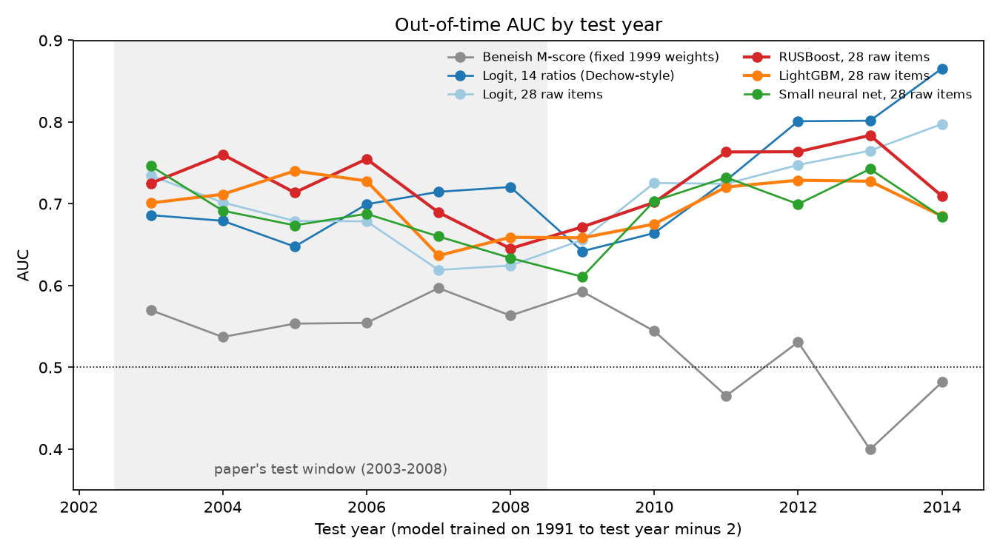
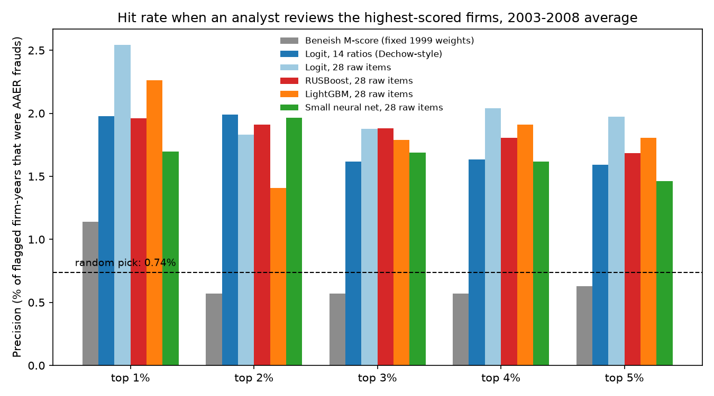

# Accounting Fraud Detection: Beneish vs Machine Learning, Out-of-Time

Can financial statements flag SEC-enforced fraud a year ahead? RUSBoost replicates Bao et al. (2020) on AUC (0.715 vs 0.723, 2003-2008), the Beneish M-score barely beats chance (0.563), and no model is clearly better at the top 1%.

      

<table><tr>
<td></td>
<td></td>
</tr></table>

## Results

Test years 2003-2008, trained on 1991 to t-2, top 1% of scores flagged (`results/results.md`).

| Model | AUC | Precision top 1% | Frauds caught | Paper AUC / caught |
|---|---|---|---|---|
| Beneish M-score (fixed 1999 weights) | 0.563 | 1.14% | 4 of 261 | - |
| Logit, 14 ratios (Dechow-style) | 0.691 | 1.98% | 7 of 261 | 0.671 / 8 |
| RUSBoost, 28 raw items (5 seeds) | 0.715 (0.710-0.718) | 1.96% | 7.0 (6-9) of 261 | 0.723 / 10 |
| LightGBM, 28 raw items | 0.696 | 2.26% | 8 of 261 | - |
| RUSBoost **without** serial-fraud fix (leaky) | 0.778 | - | 18.4 of 261 | - |

Random selection hits 0.74%. Paper figures are quoted from Bao et al. (2021), *Econ Journal Watch* 18(1), Table 1B (corrected protocol).

## Proof

- 14 pytest tests: Beneish formula and hand-computed components; out-of-time splitter (no training year after t-2, serial-fraud cases never positive in training, input not mutated); metrics follow the authors' MATLAB `evaluate.m` definitions.
- One command (`make all`) rebuilds everything; the committed run took 14.7 min with 582 MB peak RAM (`results/run_info.json`).
- Data: Bao, Ke, Li, Yu & Zhang (2020), "Detecting Accounting Fraud in Publicly Traded U.S. Firms Using a Machine Learning Approach", *Journal of Accounting Research* 58(1): 199-235, [data/code](https://github.com/JarFraud/FraudDetection). Downloaded at a pinned commit with SHA-256 check; not redistributed.
- Deterministic: fixed seeds; two full runs gave byte-identical per-year metrics.
- Out-of-time protocol from the paper: rolling test years 2003-2014, 2-year gap, serial-fraud cases relabelled in training by AAER id (per the 2022 erratum).

## Stack

Python 3.14 · numpy 2.5.4 · pandas 3.1.0 · scikit-learn 1.9.1 · imbalanced-learn 0.14.2 · lightgbm 4.7.0 · matplotlib 3.11.2 · pytest 9.2.0

## Run

```bash
make all    # venv + pinned deps, pytest, download data, full pipeline -> results/, figures/
```

## Structure

```
src/frauddetect/  data.py  beneish.py  splits.py  metrics.py  models.py  run.py
tests/            test_beneish.py  test_splits.py
results/          metrics by year and window, paper figures, SHAP, explained examples
figures/          auc_by_year.png  topk_precision.png  shap_importance.png
docs/DETAILS.md   method, results vs paper, forensic use, limitations
```

Full method, limitations and interview-level detail: [docs/DETAILS.md](docs/DETAILS.md) · MIT License

Every number here is produced by the code in this repo.
