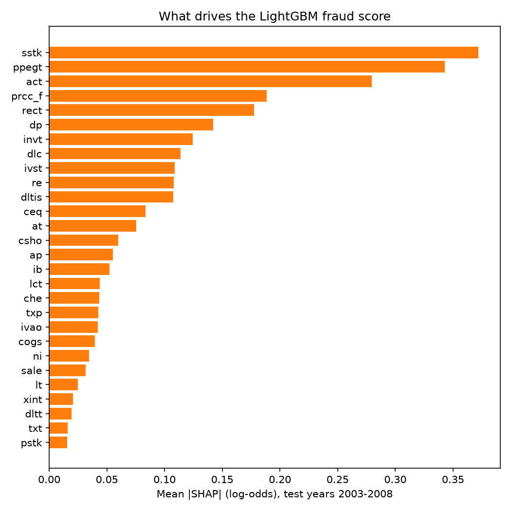

# Accounting fraud detection: full write-up

**Question.** Can a model built only from a firm's annual financial statements tell
which firm-years the SEC will later call fraudulent? And does machine learning
actually beat the classic Beneish M-score and a Dechow-style ratio logit when you
test it the way it would be used: train on the past, score a future year?

**Short answer.** Partly. On the paper's 2003-2008 test window, RUSBoost on 28 raw
accounting items reaches an out-of-time AUC of 0.715 (seed range 0.710-0.718),
close to the 0.723 that Bao et al. report under the same corrected protocol. The
Beneish M-score, applied with its fixed 1999 weights, is barely better than chance
(AUC 0.563). But at the top 1% of scores, the number an investigator actually cares
about, every learned model catches only 6-9 frauds out of 261 over six years, and the
differences between them are a few firm-years. The replication of the AUC succeeds;
the paper's claim that RUSBoost is clearly better at the top of the list does not
show up in this run.

All numbers below are read from `results/` files written by `python -m frauddetect.run`.
The "paper" columns are quoted, not computed (source given in each table).

## 1. Data

Bao, Y., Ke, B., Li, B., Yu, Y. J., & Zhang, J. (2020). Detecting Accounting Fraud in
Publicly Traded U.S. Firms Using a Machine Learning Approach. *Journal of Accounting
Research*, 58(1), 199-235. https://doi.org/10.1111/1475-679X.12292.
Erratum: *Journal of Accounting Research* 60(4), 2022.
Data and code: https://github.com/JarFraud/FraudDetection

- 146,045 U.S. firm-years, fiscal 1990-2014 (Compustat), 964 fraud firm-years from 412
  distinct AAER cases (`results/data_summary.json`). Fraud rate 0.66%.
- Label `misstate` = 1 if the firm-year is covered by an SEC Accounting and Auditing
  Enforcement Release. `p_aaer` identifies the fraud case and is used for serial fraud.
- Features: the 28 raw Compustat items and the 14 financial ratios shipped with the file.
  Identifiers are `gvkey` and `fyear` only; no company names are used.
- The repository has no license file, so the CSV is **not** redistributed here. The
  code downloads it from a pinned commit (`2d10bc6`) and verifies its SHA-256 before use.

Fraud labels thin out over time (69 in 2003, 26 in 2008, 4 in 2014) because AAERs
arrive years after the misstatement. Later test years have fewer, and less complete,
labels.

## 2. Method

### Out-of-time protocol (as in the paper)
For each test year *t* in 2003-2014, train on fiscal 1991 to *t*-2 and score year *t*.
The two-year gap reflects that a fraud is usually not public until well after the
filing. Implemented in `src/frauddetect/splits.py` and covered by `tests/test_splits.py`.

### Serial fraud
A fraud case often spans several years. If case X is fraudulent in the test year and
also has fraud years in the training window, those training years are relabelled 0, so
a model cannot score well just by recognising a firm it was already told is a fraudster.
This follows the paper's Section 3.3 as corrected in the 2022 erratum: cases are matched
on the AAER id (`p_aaer`). The original paper matched on a modified id that split some
cases in two; Walker (2021) showed that this let the same fraud appear in training and
test, and the published top-1% precision of 4.5% fell to 2.5% when he fixed it. The public
dataset now ships only `p_aaer`.

### Models
| Model | Inputs | Notes |
|---|---|---|
| Beneish M-score | 8 indices built from raw items | Fixed 1999 coefficients, no training. |
| Logit (Dechow-style) | 14 ratios | Training-window winsorizing (1/99%), median fill, standardised. |
| Logit | 28 raw items | Signed log transform, then as above. |
| RUSBoost | 28 raw items | 300 trees, learning rate 0.1, min leaf 5, 1:1 random undersampling each round (the paper's settings). `imblearn` implementation, 5 seeds. |
| LightGBM | 28 raw items | Size picked on the paper's validation design (train 1991-1999, validate 2001): 100 trees, 7 leaves (`results/lightgbm_tuning.csv`). |
| Small neural net | 28 raw items | 32-16 MLP, bag of 5, each trained on all frauds plus 10x random non-frauds. |

No hyperparameter ever looked at a test year.

### Beneish M-score from this data
`src/frauddetect/beneish.py`, tested in `tests/test_beneish.py`:

M = -4.84 + 0.920 DSRI + 0.528 GMI + 0.404 AQI + 0.892 SGI + 0.115 DEPI - 0.172 SGAI + 4.679 TATA - 0.327 LVGI

What the data allows, and what it doesn't:
- **SGAI cannot be computed**: SG&A (`xsga`) is not in the dataset. It is set to 1 (neutral).
- **AQI and DEPI use gross PP&E** (`ppegt`); Beneish used net PP&E. With gross PP&E the
  "soft asset" share is often negative, so AQI is defined for only about 30% of firm-years.
- **TATA uses Beneish's original balance-sheet accruals** (change in current assets less
  cash, less change in current liabilities excluding current debt and taxes payable,
  less depreciation, over total assets). This is exact, not an approximation.
- Prior-year values come from the same panel. Where the prior year is missing or a ratio
  is undefined, the index is set to its neutral value. Indices are winsorized at 1/99%
  within each fiscal year using features only.
- Coverage per component is in `results/data_summary.json`; 27% of firm-years have all
  seven computable components.

### Metrics (the paper's)
Ported from the authors' `evaluate.m` (`src/frauddetect/metrics.py`): AUC, and over the
top 1% of firm-years by score (k = round(0.01 x n), MATLAB rounding) NDCG@k, sensitivity
and precision. Per-year metrics are averaged over the window, as in the paper.

## 3. Results

### 2003-2008, the paper's main window (top 1%)

| Model | AUC | NDCG@k | Precision top 1% | Frauds caught | Paper AUC | Paper NDCG@k | Paper precision | Paper caught |
|---|---|---|---|---|---|---|---|---|
| Beneish M-score | 0.563 | 0.016 | 1.14% | 4 of 261 | - | - | - | - |
| Logit, 14 ratios | 0.691 | 0.030 | 1.98% | 7 of 261 | 0.671 | 0.027 | 2.62% | 8 |
| Logit, 28 raw items | 0.673 | 0.022 | 2.54% | 9 of 261 | 0.684 | 0.004 | 0.57% | 2 |
| RUSBoost, 28 raw items | 0.715 (0.710-0.718) | 0.017 | 1.96% | 7.0 (6-9) of 261 | 0.723 | 0.024 | 2.81% | 10 |
| LightGBM, 28 raw items | 0.696 | 0.027 | 2.26% | 8 of 261 | - | - | - | - |
| Small neural net | 0.682 | 0.016 | 1.70% | 6 of 261 | - | - | - | - |

Top 1% = 352 firm-years flagged across the six years. Random selection would hit 0.74%.
RUSBoost: mean over 5 seeds, range in brackets.
Paper columns quoted from Bao, Ke, Li, Yu & Zhang (2021), "A Response to 'Critique of an
Article on Machine Learning in the Detection of Accounting Fraud'", *Econ Journal Watch*
18(1): 71-78, Table 1 Panel B (the corrected serial-fraud handling).


### Other windows (from `results/results.md`)

| Window | RUSBoost AUC (paper) | Logit-14 AUC (paper) | RUSBoost caught (paper) | Logit-14 caught (paper) |
|---|---|---|---|---|
| 2003-2005 | 0.733 (0.743) | 0.671 (0.648) | 6.6 of 172 (9) | 0 of 172 (2) |
| 2003-2014 | 0.724 (0.720) | 0.721 (0.702) | 10.6 of 373 (13) | 11 of 373 (11) |

### What replicated and what did not
- **AUC replicated.** RUSBoost is within about 0.01 of the paper in every window (0.715 vs 0.723
  for 2003-2008), and it has the best average AUC of the six models in all three windows.
- **Its top-of-list advantage did not.** At the top 1%, RUSBoost caught 7.0 frauds on
  average against the paper's 10, and the simpler raw-item logit (9) and LightGBM (8)
  caught as many or more. With 261 frauds and 352 flags over six years, a gap of 2-3
  firm-years is noise. The RUSBoost seed range alone is 6-9.
- **Likely reasons for the gap**: `imblearn`'s RUSBoost (SAMME AdaBoost) is not MATLAB's
  `fitensemble` RUSBoost (AdaBoost.M2 variant), trees and resampling differ, and the paper
  itself reports a re-run giving 15 instead of 16 hits on its own code (Walker 2021).
- **Our logits do not match the paper's**, in both directions (raw-item logit catches 9
  vs 2; ratio logit 7 vs 8). Preprocessing of the logits is not specified in the paper;
  I winsorize, fill and standardise, which helps the raw-item logit a lot.
- **2003-2005 vs later years.** All learned models are at their best early in the window,
  and the ratio logit catches nothing in the top 1% in 2003-2005 (0 of 172). The ratio
  logit's AUC climbs after 2009 while labels get sparse (4 frauds in 2014), so late-year
  AUCs rest on very few positives.

### Serial fraud matters more than the choice of model

| Model, 2003-2008 | AUC with fix | AUC without fix | Caught with fix | Caught without fix |
|---|---|---|---|---|
| RUSBoost | 0.715 | 0.778 | 7.0 | 18.4 |
| LightGBM | 0.696 | 0.735 | 8.0 | 14.0 |

If you let a fraud case appear in both training and test, RUSBoost appears to catch
2.6x as many frauds. That is memorising the firm, not detecting fraud. This is the single
biggest effect in the repo, larger than any model-vs-model difference.

### The Beneish M-score on modern data
- Ranking AUC 0.563 in 2003-2008 and 0.533 in 2003-2014; it drops below 0.5 in some later years.
- At its published cut-off (M > -1.78) it flags 15.0% of all firm-years, with precision
  0.81% against a 0.74% base rate and recall of 16.5% (`results/mscore_threshold.json`).
  In practice that is a list of 5,290 firm-years with almost no lift.
- Caveats that cut against the M-score here: SGAI is missing, AQI/DEPI use gross PP&E,
  and the weights were fitted on 1982-1992 manipulators, not AAER firms of the 2000s.

## 4. Explainability

TreeSHAP values from the LightGBM model (`results/lightgbm_mean_abs_shap_by_year.csv`,
`figures/shap_importance.png`). RUSBoost impurity importance is in
`results/rusboost_feature_importance.csv`; its top items are stock issuance (`sstk`),
gross PP&E, share price, shares outstanding and receivables.



Two firm-years from 2003-2008 (`results/explained_examples.json`):

**Highest score overall**: gvkey 16477, fiscal 2006, rank 1 of 5,908, **not** an AAER
fraud year. The drivers are scale (current assets of $3.9bn against a median of $67m,
payables $2.3bn), a $199m stock issuance and a $710m loss. That is what a raw-item model
tends to put at the top: large firms raising equity while losing money.

**Highest-ranked actual fraud**: gvkey 238616, fiscal 2008, rank 3 of 5,612, AAER
label 1. Drivers: very large current assets and current liabilities ($26.6bn and $25.4bn),
a $75m stock issuance, large COGS and receivables of $18.6bn, offset by large gross PP&E.
Its M-score was -2.59, below the -1.78 cut-off, so Beneish would not have flagged it.

The size effect is a real limitation: raw dollar items let the model learn "big and
complicated" as a fraud signal. AAER enforcement is itself skewed toward larger firms,
so this is partly a label effect, not only a model effect.

## 5. What a forensic analyst would do with the flags

The score is a triage tool, not evidence. In practice:
1. **Take the top 1-2% each year** (roughly 60-120 firms) as a review queue. At about 2%
   precision, expect one or two real AAER cases per 60 firms reviewed, versus 0.7% at random.
2. **Read the drivers first.** If a firm is flagged on size alone, deprioritise it. If it
   is flagged on receivables growing faster than sales, inventory build-up, accruals or
   fresh equity issuance, those are the classic revenue-recognition and
   "dress-up-before-raising-capital" patterns.
3. **Go to the filings.** Revenue recognition notes, allowance for doubtful accounts,
   related-party transactions, auditor changes, late filings, restatements, management
   turnover, short-seller reports.
4. **Pull the time series.** One flagged year is weak; three years of DSRI and accruals
   trending up is stronger.
5. **Calibrate the threshold to capacity.** The top-k metrics answer "if my team can
   review k firms, how many hits do I get?", which is the decision a forensic or audit
   team actually faces.

## 6. Limitations

- **Tiny positive counts.** 26-69 frauds per test year; the top 1% is about 60 firms.
  Differences of a few firm-years between models are not meaningful.
- **Labels are AAERs only.** Most misstatements never get an AAER. "Non-fraud" means
  "not caught by the SEC", and detection is uneven across firms and years.
- **Hindsight in the training labels.** The training set uses AAER labels as known today,
  not as known at the time of prediction; the two-year gap only partly fixes that, as in
  the paper.
- **Beneish is handicapped by the data** (no SG&A, gross not net PP&E), so its result is
  "Beneish as computable from these 28 items", not a definitive test of the M-score.
- **Not the paper's exact RUSBoost.** Python `imblearn` vs MATLAB `fitensemble`.
- **No restatement, text, governance or market data.** Those are where much of the
  remaining signal is likely to be.

## 7. How to run

```bash
make all            # venv, pinned packages, pytest, full pipeline
# or step by step
python3 -m venv .venv && .venv/bin/pip install -r requirements.txt && .venv/bin/pip install -e .
.venv/bin/python -m pytest -q
.venv/bin/python -m frauddetect.run
```

The run downloads the dataset (48 MB), checks its hash, and rewrites `results/` and
`figures/`. Runtime and peak memory of the committed run are in `results/run_info.json`.
Random seeds are fixed (RUSBoost seeds 0-4; LightGBM, MLP seed 0).

## References
- Bao, Ke, Li, Yu & Zhang (2020), *Journal of Accounting Research* 58(1): 199-235; Erratum, *JAR* 60(4), 2022.
- Bao, Ke, Li, Yu & Zhang (2021), A Response to "Critique of an Article on Machine Learning in the Detection of Accounting Fraud", *Econ Journal Watch* 18(1): 71-78.
- Walker, S. (2021), Critique of an Article on Machine Learning in the Detection of Accounting Fraud, *Econ Journal Watch* 18(1): 61-70.
- Beneish, M. D. (1999), The Detection of Earnings Manipulation, *Financial Analysts Journal* 55(5): 24-36.
- Dechow, Ge, Larson & Sloan (2011), Predicting Material Accounting Misstatements, *Contemporary Accounting Research* 28(1): 17-82.

Every number here is produced by the code in this repo.
